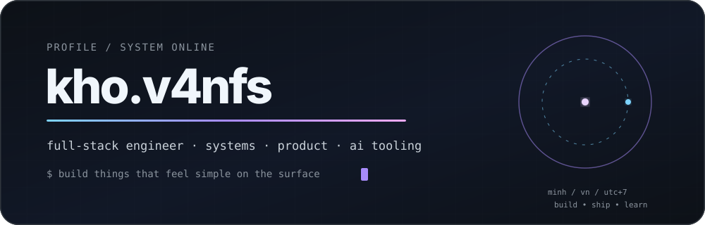
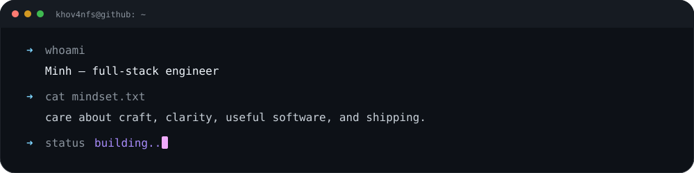
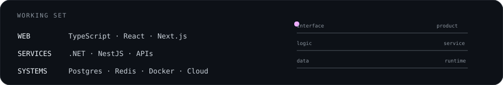
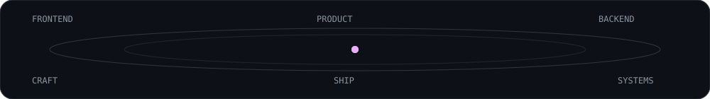
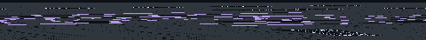

<div align="center">



<br />

<a href="https://github.com/khov4nfs"><b>github</b></a>
&nbsp;&nbsp;·&nbsp;&nbsp;
<a href="mailto:minhpnq1807@gmail.com"><b>email</b></a>
&nbsp;&nbsp;·&nbsp;&nbsp;
<code>kho.v4nfs</code>

<br /><br />


</div>


### `01 / identity`



I’m **Minh**, a full-stack engineer who likes the whole path from interface → service → data → runtime.

I care more about **useful software, good system boundaries, clear product thinking, and shipping** than collecting a wall of framework badges. AI is part of the toolbox when it removes friction — not when it adds noise.


### `02 / working set`



<sub>
My stack changes with the problem. The constants are typed interfaces, understandable APIs, pragmatic architecture, observable systems, and UI that feels intentional.
</sub>

<br /><br />


### `03 / what I gravitate toward`

<table>
<tr>
<td width="33%" valign="top">

**PRODUCT**

Interfaces with a point of view.  
Less chrome, clearer flows, fewer accidental decisions.

</td>
<td width="33%" valign="top">

**SYSTEMS**

Backends that stay understandable as they grow.  
Boundaries, contracts, queues, data, failure modes.

</td>
<td width="33%" valign="top">

**TOOLING**

Automation and AI that shorten the distance between intent and result.  
Context, agents, developer workflow.

</td>
</tr>
</table>

<br />




### `04 / build loop`

<div align="center">

</div>

<br />

```text
idea → shape → build → break → understand → refine → ship
```

There are projects behind this profile, but this page is intentionally **not a project catalog**. Repositories are there when you want the details; this README is just the signal.


<div align="center">

<sub>Phan Nguyen Quoc Minh · Full-stack Engineer · VN / UTC+7</sub>

<br /><br />

**`build things that feel simple on the surface.`**

<br /><br />

<a href="mailto:minhpnq1807@gmail.com">say hi →</a>

</div>
