

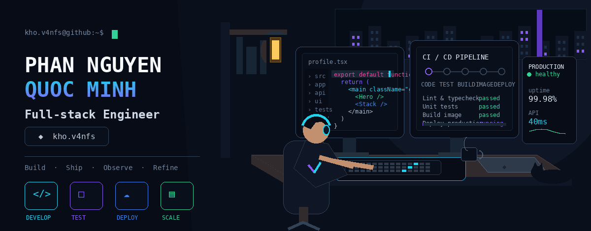

 

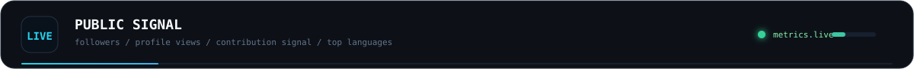

&nbsp;

  

 

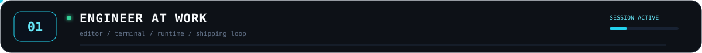

I’m **Minh**, a full-stack engineer interested in the complete delivery path — from a deliberate interface to backend boundaries, data, deployment, and runtime behavior.

 


I prefer software that is **typed, testable, observable, understandable, and actually shippable**. AI belongs in the workflow when it removes real friction, not when it adds another layer of noise.

 

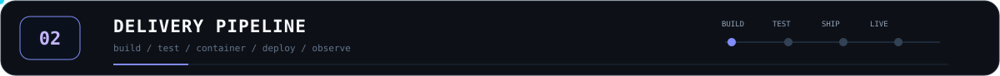

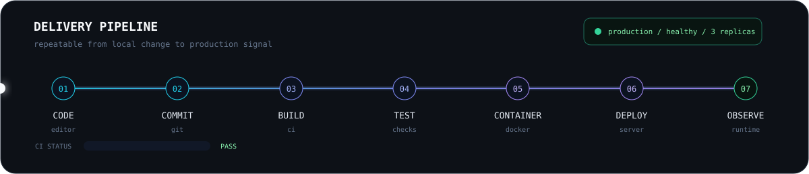

A feature is not finished at `works on my machine`. I care about repeatable builds, bounded failures, deployment feedback, and knowing what the system is doing after release.

 

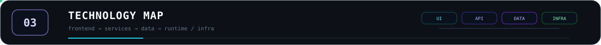

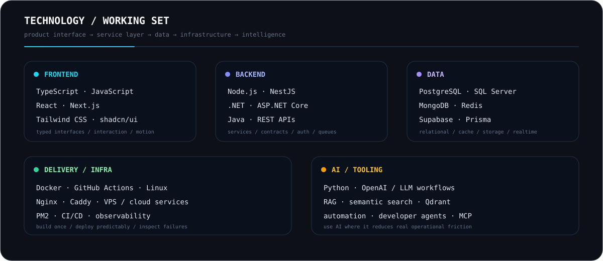

**Frontend**

 

**Backend**

 

**Data**

 

**Delivery / Infra**

 

**AI / Tooling**

 

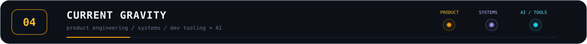

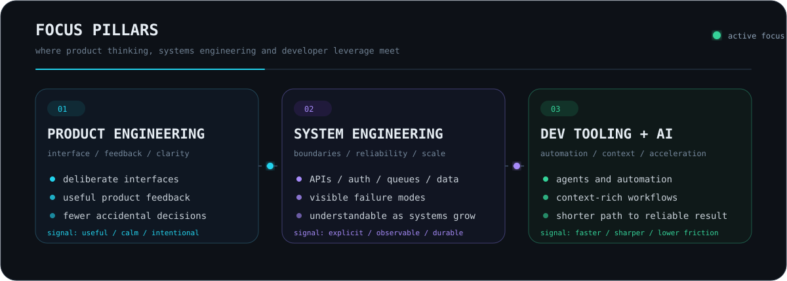

 

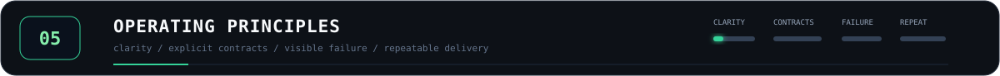

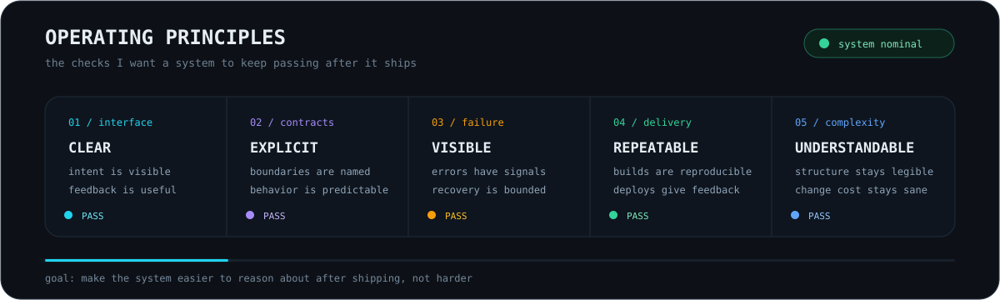

 

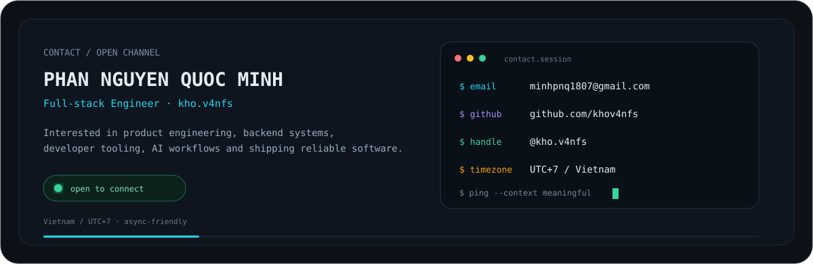

<a href="mailto:minhpnq1807@gmail.com"><b>EMAIL ↗</b></a>
&nbsp;&nbsp;&nbsp;·&nbsp;&nbsp;&nbsp;
<a href="https://github.com/khov4nfs"><b>GITHUB ↗</b></a>

