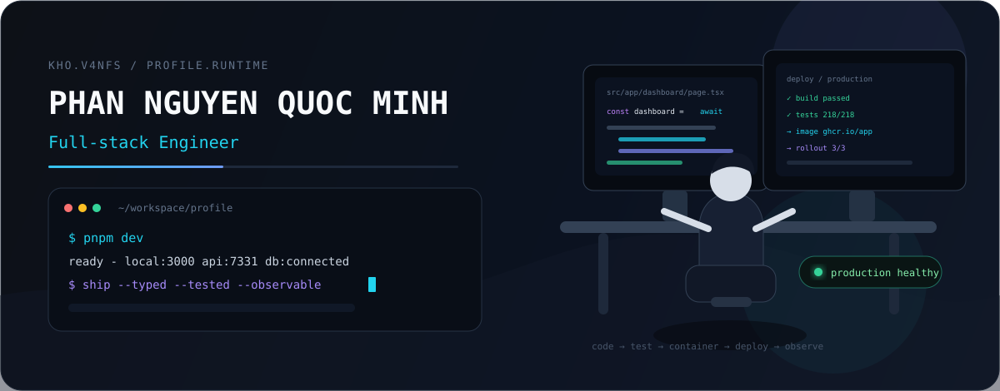

<div align="center">



<br />

<a href="https://github.com/khov4nfs"><b>github</b></a>
&nbsp;&nbsp;·&nbsp;&nbsp;
<a href="mailto:minhpnq1807@gmail.com"><b>email</b></a>
&nbsp;&nbsp;·&nbsp;&nbsp;
<code>kho.v4nfs</code>

</div>

<br />

### `01 / engineer at work`

I’m **Minh**, a full-stack engineer interested in the complete delivery path — from a deliberate interface to backend boundaries, data, deployment, and runtime behavior.


I prefer software that is **typed, testable, observable, understandable, and actually shippable**. AI belongs in the workflow when it removes real friction, not when it adds another layer of noise.

<br />

### `02 / delivery is part of the build`


```text
code → commit → build → test → container → deploy → observe
```

A feature is not finished at `works on my machine`. I care about repeatable builds, bounded failures, deployment feedback, and knowing what the system is doing after release.

<br />

### `03 / technology working set`


<div align="center">

**Frontend**


<br />

**Backend**


<br />

**Data**


<br />

**Delivery / Infra**


<br />

**AI / Tooling**


</div>

<br />

### `04 / what I gravitate toward`

<table>
<tr>
<td width="33%" valign="top">

**PRODUCT ENGINEERING**

Interfaces with a point of view, clear flows, useful feedback, and fewer accidental decisions.

</td>
<td width="33%" valign="top">

**SYSTEM ENGINEERING**

Backend boundaries, APIs, auth, queues, data, failure modes, and systems that remain understandable as they grow.

</td>
<td width="33%" valign="top">

**DEV TOOLING + AI**

Automation, agents, context systems, RAG, and tooling that shorten the distance between intent and a reliable result.

</td>
</tr>
</table>

<br />

### `05 / operating principles`

```text
make the interface clear
make the contracts explicit
make failure visible
make deployment repeatable
make the system easier to understand than before
```

This profile is intentionally **not a project catalog**. The repositories carry the implementation details; this page describes how I like to build.

<br />

<div align="center">

<sub>Phan Nguyen Quoc Minh · Full-stack Engineer · Vietnam / UTC+7</sub>

<br /><br />

**`build → verify → ship → observe → refine`**

<br /><br />

<a href="mailto:minhpnq1807@gmail.com">say hi →</a>

</div>
